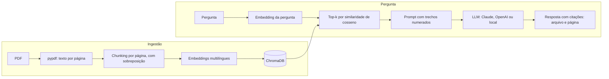

# 📄 RAG Documentos

> Pergunte aos seus PDFs e veja **de qual arquivo e página** veio cada resposta.

[](https://github.com/Rafael-Pedra-7325/rag-documentos/actions/workflows/ci.yml)


Assistente de **RAG** (*Retrieval-Augmented Generation*): você envia PDFs, o sistema indexa o conteúdo em um banco vetorial e responde perguntas em linguagem natural **usando apenas os trechos recuperados**, citando arquivo e página para que a resposta possa ser conferida.

<!-- Depois de rodar o projeto, tire um print da interface, salve em docs/demo.png e descomente a linha abaixo:

-->

## Funcionalidades

- **Upload de PDFs** (interface web ou API) com extração de texto página a página.
- **Busca vetorial** com embeddings multilíngues (funciona bem em português) e ChromaDB.
- **Citação da página de origem**: cada resposta traz os trechos usados, com arquivo, página e score de similaridade. As fontes realmente citadas pelo modelo ficam destacadas.
- **LLM intercambiável**: Claude (Anthropic), qualquer API compatível com OpenAI (OpenAI, Ollama, LM Studio, vLLM) ou modo extrativo, que roda **sem LLM e sem internet**.
- **Filtro por documento**: restrinja a pergunta a um ou mais PDFs.
- **Reenvio idempotente**: subir o mesmo PDF de novo substitui a versão anterior, sem duplicar trechos.
- **Anti-alucinação**: o prompt obriga a responder só com os trechos e a admitir quando a informação não está nos documentos.
- **Avaliação de recuperação** embutida (`rag-docs eval`): Hit@k e MRR sobre um conjunto de perguntas.
- API REST documentada (Swagger em `/docs`), CLI, Docker e CI no GitHub Actions.

## Como funciona



1. **Ingestão**: o PDF é lido página a página; o texto é limpo (hifenização de quebra de linha, espaços) e dividido em *chunks* de ~900 caracteres com sobreposição, **sem nunca cruzar o limite de uma página**. Assim, todo trecho recuperado pertence a exatamente uma página.
2. **Indexação**: cada chunk vira um vetor (`intfloat/multilingual-e5-small` por padrão) e é gravado no ChromaDB com metadados (documento, arquivo, página).
3. **Consulta**: a pergunta é vetorizada, os *k* trechos mais próximos são recuperados e enviados ao LLM como contexto numerado (`[1]`, `[2]`...).
4. **Resposta**: o modelo responde citando os números; a API devolve a resposta e a lista de fontes.

## Stack

| Camada | Tecnologia |
| --- | --- |
| API e interface | FastAPI, Uvicorn, HTML/JS puro (sem build) |
| Extração de PDF | pypdf |
| Embeddings | sentence-transformers (`multilingual-e5-small`) |
| Banco vetorial | ChromaDB (cosseno) · alternativa em NumPy, sem dependências |
| LLM | Anthropic Claude · API compatível com OpenAI · modo extrativo |
| Qualidade | pytest, ruff, GitHub Actions, Docker |

## Início rápido

Requisitos: Python 3.10+.

```bash
git clone https://github.com/Rafael-Pedra-7325/rag-documentos.git
cd rag-documentos
python -m venv .venv
source .venv/bin/activate        # Windows: .venv\Scripts\activate
```

### Opção A: modo offline (sem baixar modelo e sem chave de API)

Bom para conhecer o projeto em 1 minuto. Usa um embedder lexical leve e o modo extrativo (mostra os trechos mais relevantes em vez de escrever a resposta).

```bash
pip install -e .
cp .env.example .env             # Windows: copy .env.example .env
# no .env, defina: EMBEDDING_BACKEND=hashing  e  VECTOR_STORE=numpy
uvicorn rag_documentos.api:app --reload
```

### Opção B: modo completo (embeddings neurais + ChromaDB + LLM)

```bash
pip install -e ".[all]"
cp .env.example .env             # Windows: copy .env.example .env
# no .env, preencha ANTHROPIC_API_KEY (ou OPENAI_API_KEY)
uvicorn rag_documentos.api:app --reload
```

Na primeira execução o modelo de embeddings (algumas centenas de MB) é baixado e fica em cache.

### Opção C: Docker

```bash
cp .env.example .env
docker compose up --build
```

Depois abra **http://localhost:8000** (interface) ou **http://localhost:8000/docs** (Swagger). Para testar, envie o PDF de exemplo em [`examples/manual-colaborador.pdf`](examples/manual-colaborador.pdf) e pergunte, por exemplo:

- *Quantos dias de férias eu tenho direito?*
- *Preciso usar VPN para trabalhar de casa?*
- *Qual o limite do auxílio-educação?*

## Configuração

Tudo é configurado por variáveis de ambiente (ou `.env`). Nenhuma é obrigatória.

| Variável | Padrão | Descrição |
| --- | --- | --- |
| `LLM_PROVIDER` | automático | `anthropic`, `openai` ou `extractive`. Se vazio, usa a chave disponível; sem chave, `extractive`. |
| `LLM_MODEL` | `claude-haiku-4-5` / `gpt-4o-mini` | Modelo do provedor escolhido. |
| `ANTHROPIC_API_KEY` / `OPENAI_API_KEY` | vazio | Credenciais. |
| `OPENAI_BASE_URL` | vazio | URL de servidor compatível (ex.: `http://localhost:11434/v1` para Ollama). |
| `EMBEDDING_BACKEND` | `sentence-transformers` | Ou `hashing` (offline, lexical). |
| `EMBEDDING_MODEL` | `intfloat/multilingual-e5-small` | Qualquer modelo do sentence-transformers. |
| `VECTOR_STORE` | `chroma` | Ou `numpy` (busca exata em memória, persistida em disco). |
| `CHUNK_SIZE` / `CHUNK_OVERLAP` | `900` / `150` | Tamanho dos trechos e sobreposição, em caracteres. |
| `TOP_K` | `5` | Quantos trechos vão para o LLM. |
| `MIN_SCORE` | `0.0` | Descarta trechos com similaridade menor que isto. |
| `MAX_UPLOAD_MB` | `25` | Tamanho máximo do PDF. |
| `DATA_DIR` | `data` | Onde ficam o índice e o registro de documentos. |

> **Sobre o `MIN_SCORE`:** a escala de similaridade depende do modelo. Modelos E5 dão scores altos (~0,7 a 0,9) mesmo para trechos pouco relacionados, então o filtro vem desligado. Meça no seu corpus antes de ligá-lo.

## API

| Método | Rota | Descrição |
| --- | --- | --- |
| `POST` | `/api/documents` | Envia e indexa um PDF (`multipart/form-data`, campo `file`). |
| `GET` | `/api/documents` | Lista os documentos indexados. |
| `DELETE` | `/api/documents/{doc_id}` | Remove um documento do índice. |
| `POST` | `/api/query` | Faz uma pergunta. Corpo: `question`, `top_k` (opcional), `doc_ids` (opcional). |
| `GET` | `/api/health` | Status, modelo de embeddings e LLM em uso. |

```bash
curl -F "file=@examples/manual-colaborador.pdf" http://localhost:8000/api/documents

curl -X POST http://localhost:8000/api/query \
  -H "Content-Type: application/json" \
  -d '{"question": "Quantos dias de férias eu tenho direito?"}'
```

Formato da resposta (exemplo ilustrativo):

```json
{
  "answer": "Após 12 meses de trabalho, você tem direito a 30 dias corridos de férias [1].",
  "sources": [
    {
      "ref": 1,
      "doc_id": "80841d9119a113ab",
      "filename": "manual-colaborador.pdf",
      "page": 2,
      "score": 0.8731,
      "text": "Após 12 meses de trabalho, o colaborador tem direito a 30 dias corridos...",
      "cited": true
    }
  ],
  "model": "claude-haiku-4-5"
}
```

## CLI

```bash
rag-docs ingest examples/manual-colaborador.pdf
rag-docs ask "Qual o valor do vale-refeição?"
rag-docs list
rag-docs delete <doc_id>
```

## Avaliando a recuperação

RAG sem métrica é palpite. O comando abaixo indexa o PDF de exemplo em memória e mede se a página correta aparece entre os *k* primeiros resultados para cada pergunta de [`examples/eval_questions.json`](examples/eval_questions.json):

```bash
rag-docs eval --pdf examples/manual-colaborador.pdf --questions examples/eval_questions.json -k 3
```

Com o embedder offline (`--embedding hashing`) o resultado é **Hit@1 85%, Hit@3 100% e MRR 0,92** nas 13 perguntas do exemplo. É um conjunto pequeno e ilustrativo: use o mesmo comando com `--embedding sentence-transformers` para comparar com o modelo neural, e crie suas próprias perguntas para o seu corpus.

## Decisões de projeto

- **Chunks nunca cruzam páginas.** Perde-se um pouco de contexto em frases que atravessam a quebra de página, mas ganha-se citação de página exata, que é o diferencial para o usuário conferir a resposta.
- **Embeddings E5 com prefixos `query:`/`passage:`.** Esses modelos foram treinados assim; omitir os prefixos degrada a busca. O código adiciona os prefixos automaticamente.
- **Os trechos são tratados como dados, não como instruções.** O prompt de sistema manda ignorar ordens contidas nos documentos, como mitigação básica de *prompt injection*.
- **Ingestão idempotente.** O `doc_id` é o hash do conteúdo do arquivo, então reenviar o mesmo PDF substitui o anterior.
- **Interfaces pequenas e trocáveis** (`Embedder`, `VectorStore`, `LLM`): adicionar FAISS, outro provedor de LLM ou outro modelo de embeddings é implementar 2 ou 3 métodos.
- **Sem temperatura fixa nas chamadas de LLM**, por compatibilidade: alguns modelos novos restringem parâmetros de amostragem.

## Limitações conhecidas

- **PDFs escaneados** (só imagem) não têm texto extraível; o sistema avisa, mas ainda não faz OCR.
- Tabelas e layouts de várias colunas podem sair com a ordem do texto embaralhada, uma limitação do `pypdf`.
- Cada pergunta é independente (sem memória de conversa).
- Sem autenticação: pensado para uso local ou atrás de um proxy. Rode com **um único worker** do Uvicorn, pois o ChromaDB local e o lock de escrita são por processo.

## Próximos passos

- [ ] Busca híbrida (BM25 + vetorial) com *reciprocal rank fusion*
- [ ] *Reranker* cross-encoder sobre os top-k
- [ ] OCR para PDFs escaneados
- [ ] Respostas em *streaming* (SSE)
- [ ] Reescrita da pergunta para conversas de vários turnos
- [ ] Backend FAISS e avaliação de geração (fidelidade e relevância)
- [ ] Autenticação por chave de API

## Testes

```bash
pip install -e ".[dev]"
ruff check .
pytest
```

Os testes não baixam modelos nem chamam APIs: usam o embedder offline, o armazenamento em NumPy e um LLM falso.

## Estrutura

```text
rag-documentos/
├── src/rag_documentos/
│   ├── api.py           # FastAPI: rotas REST e interface web
│   ├── service.py       # pipeline RAG: ingestão, busca e resposta
│   ├── pdf.py           # extração e limpeza de texto por página
│   ├── chunking.py      # divisão em trechos, preservando a página
│   ├── embeddings.py    # sentence-transformers e embedder offline
│   ├── vectorstore.py   # ChromaDB e armazenamento em NumPy
│   ├── llm.py           # Claude, OpenAI-compatível e modo extrativo
│   ├── evaluation.py    # Hit@k e MRR
│   ├── registry.py      # registro dos documentos indexados
│   ├── config.py        # configuração por variáveis de ambiente
│   ├── cli.py           # comando rag-docs
│   └── static/index.html
├── tests/               # pytest
├── examples/            # PDF de exemplo e perguntas de avaliação
├── scripts/make_sample_pdf.py
├── Dockerfile · docker-compose.yml · .github/workflows/ci.yml
└── pyproject.toml
```

## English summary

**RAG Documentos** is a document Q&A assistant. Upload PDFs, and it answers natural-language questions using only the retrieved passages, citing the **source file and page**. Built with Python, FastAPI, multilingual sentence-transformers embeddings and ChromaDB. The LLM layer is pluggable (Claude, any OpenAI-compatible endpoint, or a no-LLM extractive mode), page-aware chunking keeps citations exact, and a built-in evaluation command reports Hit@k and MRR. See *Início rápido* above to run it locally or with Docker.

## Autor

**Rafael Pedra** · [GitHub](https://github.com/Rafael-Pedra-7325) · [LinkedIn](https://www.linkedin.com/in/rafael-pedra-833930166)

## Licença

[MIT](LICENSE)
